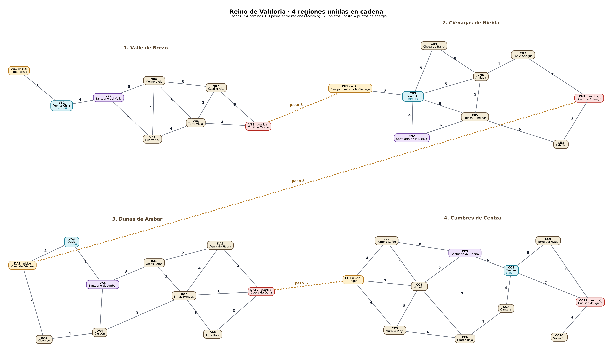
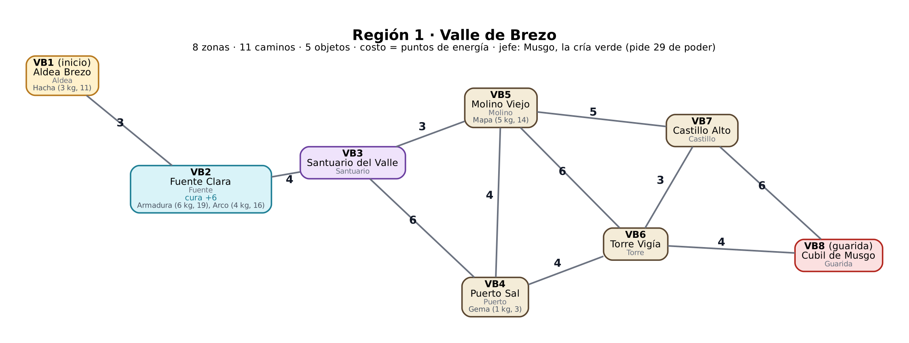
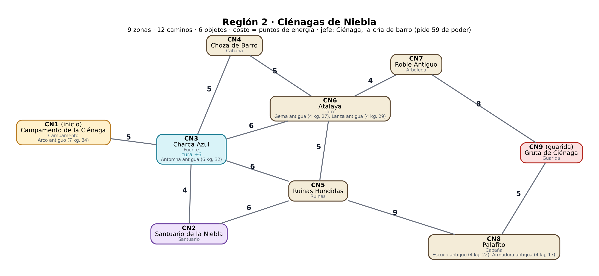
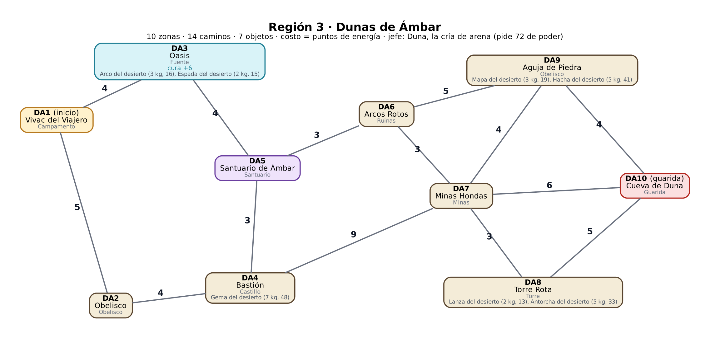
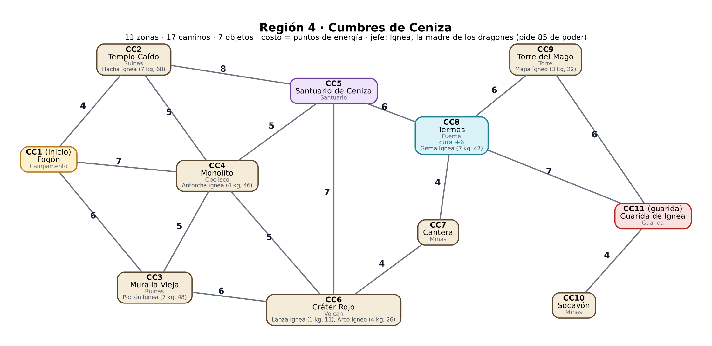

# TPO Programación III — Grupo 12 · Valdoria

## Integrantes

* Luka Kishima (@lukakishima)
* Juan Pedro Sama (@jpsam4)
* Joaquin Castellano (@joaquingit1)

## Dominio: el reino de Valdoria

Un juego de rol. Hace un siglo, el Archivo de Valdoria guardaba las *Reliquias del Cálculo*. Ignea, la madre de los dragones, lo quemó, y sus crías se repartieron el reino. El jugador cruza **cuatro regiones**: en cada una sale del inicio, gasta energía caminando, junta objetos en una mochila con capacidad limitada y llega a la guarida con el poder suficiente para vencer a la cría. La última guarida es la de Ignea.

Las cuatro regiones son **fijas**: el mapa, los objetos y los costos no cambian entre partidas. Esos mismos datos son los que se cargan en Neo4j y contra los que se escriben los tests.

### Nodo, arista y costo

| Lo que pide el Hito 3 | En Valdoria |
|---|---|
| **Qué es un nodo** | Una **zona** del reino: aldea, campamento, fuente, santuario, guarida… (38 en total). |
| **Qué es una arista** | Un **camino** entre dos zonas vecinas, de ida y vuelta (grafo no dirigido). La guarida de cada región se une con el inicio de la siguiente por un **paso**. |
| **Qué representa el costo y en qué unidad** | La **energía** que gasta el personaje al recorrer el camino, medida en **puntos de energía** (enteros positivos). Ejemplo: el camino entre la Aldea Brezo y la Fuente Clara cuesta 3 puntos de energía. |

### Qué es cada cosa en el modelo

| Concepto | En Valdoria | En el modelo |
|---|---|---|
| **Nodo** | Una zona del reino: aldea, campamento, fuente, santuario, guarida… | `Nodo` con `id` (código de región + número), `nombre`, `tipo` |
| **Arista** | Un camino entre dos zonas vecinas, **de ida y vuelta** | relación `CONECTA` (`Conexion`) |
| **Paso entre regiones** | El camino que une la guarida de una región con el inicio de la siguiente | también `CONECTA`, costo 5 |
| **Costo** | **Energía** que gasta el personaje en recorrer el camino. Unidad: **puntos de energía** (enteros positivos) | `Conexion.costo` |
| **Curación** | Energía que devuelve una zona al entrar (cada región tiene una fuente que cura 6) | `Nodo.valor` |
| **Item** | Objeto que se puede cargar en la mochila | `Item` con `peso` (kg), `valor` (puntos de poder) y `nodoId` |
| **Capacidad** | Peso máximo de la mochila (kg) | parámetro `capacidad` de greedy y mochila 0/1 |

**Códigos de región:** VB = Valle de Brezo · CN = Ciénagas de Niebla · DA = Dunas de Ámbar · CC = Cumbres de Ceniza. En cada región el número 1 es el inicio y el último número es la guarida.

### La prueba de los 30 segundos (`GUIA-TPO.md`)

1. **¿Qué es una arista y qué número tiene encima?** «El camino entre la Aldea Brezo (VB1) y la Fuente Clara (VB2) cuesta **3 puntos de energía**».
2. **¿Tiene sentido buscar el camino más barato pasando por zonas intermedias?** Sí: de la Aldea Brezo a la Guarida de Ignea el camino más barato atraviesa 22 zonas y cuesta 103. El grafo no es bipartito.
3. **¿Hay algo que seleccionar bajo una restricción de capacidad?** Sí: 25 objetos con peso y poder, una mochila de 10 kg y el reparto del botín entre tres personajes.

## Diagramas

### El reino completo

**38 zonas, 54 caminos + 3 pasos entre regiones (57 aristas, no dirigidas) y 25 objetos.** El número sobre cada camino es la energía que cuesta recorrerlo en cualquiera de los dos sentidos.

| Paso | Une | Costo |
|---|---|---|
| 1 | VB8 Cubil de Musgo → CN1 Campamento de la Ciénaga | 5 |
| 2 | CN9 Gruta de Ciénaga → DA1 Vivac del Viajero | 5 |
| 3 | DA10 Cueva de Duna → CC1 Fogón | 5 |

### Las cuatro regiones

#### Región 1 · Valle de Brezo

Inicio: **VB1 Aldea Brezo** · Guarida: **VB8 Cubil de Musgo** · Jefe: Musgo, la cría verde, pide **29** de poder · Energía inicial en el juego: 29

Zonas, caminos y objetos

| id | Zona | Tipo | Curación |
|---|---|---|---|
| VB1 | Aldea Brezo | Aldea |  |
| VB2 | Fuente Clara | Fuente | 6 |
| VB3 | Santuario del Valle | Santuario |  |
| VB4 | Puerto Sal | Puerto |  |
| VB5 | Molino Viejo | Molino |  |
| VB6 | Torre Vigía | Torre |  |
| VB7 | Castillo Alto | Castillo |  |
| VB8 | Cubil de Musgo | Guarida |  |

| Camino | Costo |
|---|---|
| VB1 – VB2 (Aldea Brezo – Fuente Clara) | 3 |
| VB2 – VB3 (Fuente Clara – Santuario del Valle) | 4 |
| VB3 – VB4 (Santuario del Valle – Puerto Sal) | 6 |
| VB3 – VB5 (Santuario del Valle – Molino Viejo) | 3 |
| VB4 – VB5 (Puerto Sal – Molino Viejo) | 4 |
| VB4 – VB6 (Puerto Sal – Torre Vigía) | 4 |
| VB5 – VB6 (Molino Viejo – Torre Vigía) | 6 |
| VB5 – VB7 (Molino Viejo – Castillo Alto) | 5 |
| VB6 – VB7 (Torre Vigía – Castillo Alto) | 3 |
| VB6 – VB8 (Torre Vigía – Cubil de Musgo) | 4 |
| VB7 – VB8 (Castillo Alto – Cubil de Musgo) | 6 |

| id | Objeto | Peso (kg) | Poder | Zona |
|---|---|---|---|---|
| OVB1 | Armadura | 6 | 19 | VB2 Fuente Clara |
| OVB2 | Hacha | 3 | 11 | VB1 Aldea Brezo |
| OVB3 | Mapa | 5 | 14 | VB5 Molino Viejo |
| OVB4 | Gema | 1 | 3 | VB4 Puerto Sal |
| OVB5 | Arco | 4 | 16 | VB2 Fuente Clara |

#### Región 2 · Ciénagas de Niebla

Inicio: **CN1 Campamento de la Ciénaga** · Guarida: **CN9 Gruta de Ciénaga** · Jefe: Ciénaga, la cría de barro, pide **59** de poder · Energía inicial en el juego: 38

Zonas, caminos y objetos

| id | Zona | Tipo | Curación |
|---|---|---|---|
| CN1 | Campamento de la Ciénaga | Campamento |  |
| CN2 | Santuario de la Niebla | Santuario |  |
| CN3 | Charca Azul | Fuente | 6 |
| CN4 | Choza de Barro | Cabaña |  |
| CN5 | Ruinas Hundidas | Ruinas |  |
| CN6 | Atalaya | Torre |  |
| CN7 | Roble Antiguo | Arboleda |  |
| CN8 | Palafito | Cabaña |  |
| CN9 | Gruta de Ciénaga | Guarida |  |

| Camino | Costo |
|---|---|
| CN1 – CN3 (Campamento de la Ciénaga – Charca Azul) | 5 |
| CN2 – CN3 (Santuario de la Niebla – Charca Azul) | 4 |
| CN2 – CN5 (Santuario de la Niebla – Ruinas Hundidas) | 6 |
| CN3 – CN4 (Charca Azul – Choza de Barro) | 5 |
| CN3 – CN5 (Charca Azul – Ruinas Hundidas) | 6 |
| CN3 – CN6 (Charca Azul – Atalaya) | 6 |
| CN4 – CN6 (Choza de Barro – Atalaya) | 5 |
| CN5 – CN6 (Ruinas Hundidas – Atalaya) | 5 |
| CN5 – CN8 (Ruinas Hundidas – Palafito) | 9 |
| CN6 – CN7 (Atalaya – Roble Antiguo) | 4 |
| CN7 – CN9 (Roble Antiguo – Gruta de Ciénaga) | 8 |
| CN8 – CN9 (Palafito – Gruta de Ciénaga) | 5 |

| id | Objeto | Peso (kg) | Poder | Zona |
|---|---|---|---|---|
| OCN1 | Arco antiguo | 7 | 34 | CN1 Campamento de la Ciénaga |
| OCN2 | Gema antigua | 4 | 27 | CN6 Atalaya |
| OCN3 | Lanza antigua | 4 | 29 | CN6 Atalaya |
| OCN4 | Escudo antiguo | 4 | 22 | CN8 Palafito |
| OCN5 | Antorcha antigua | 6 | 32 | CN3 Charca Azul |
| OCN6 | Armadura antigua | 4 | 17 | CN8 Palafito |

#### Región 3 · Dunas de Ámbar

Inicio: **DA1 Vivac del Viajero** · Guarida: **DA10 Cueva de Duna** · Jefe: Duna, la cría de arena, pide **72** de poder · Energía inicial en el juego: 25

Zonas, caminos y objetos

| id | Zona | Tipo | Curación |
|---|---|---|---|
| DA1 | Vivac del Viajero | Campamento |  |
| DA2 | Obelisco | Obelisco |  |
| DA3 | Oasis | Fuente | 6 |
| DA4 | Bastión | Castillo |  |
| DA5 | Santuario de Ámbar | Santuario |  |
| DA6 | Arcos Rotos | Ruinas |  |
| DA7 | Minas Hondas | Minas |  |
| DA8 | Torre Rota | Torre |  |
| DA9 | Aguja de Piedra | Obelisco |  |
| DA10 | Cueva de Duna | Guarida |  |

| Camino | Costo |
|---|---|
| DA1 – DA2 (Vivac del Viajero – Obelisco) | 5 |
| DA1 – DA3 (Vivac del Viajero – Oasis) | 4 |
| DA2 – DA4 (Obelisco – Bastión) | 4 |
| DA3 – DA5 (Oasis – Santuario de Ámbar) | 4 |
| DA4 – DA5 (Bastión – Santuario de Ámbar) | 3 |
| DA4 – DA7 (Bastión – Minas Hondas) | 9 |
| DA5 – DA6 (Santuario de Ámbar – Arcos Rotos) | 3 |
| DA6 – DA7 (Arcos Rotos – Minas Hondas) | 3 |
| DA6 – DA9 (Arcos Rotos – Aguja de Piedra) | 5 |
| DA7 – DA8 (Minas Hondas – Torre Rota) | 3 |
| DA7 – DA9 (Minas Hondas – Aguja de Piedra) | 4 |
| DA7 – DA10 (Minas Hondas – Cueva de Duna) | 6 |
| DA8 – DA10 (Torre Rota – Cueva de Duna) | 5 |
| DA9 – DA10 (Aguja de Piedra – Cueva de Duna) | 4 |

| id | Objeto | Peso (kg) | Poder | Zona |
|---|---|---|---|---|
| ODA1 | Mapa del desierto | 3 | 19 | DA9 Aguja de Piedra |
| ODA2 | Lanza del desierto | 2 | 13 | DA8 Torre Rota |
| ODA3 | Arco del desierto | 3 | 16 | DA3 Oasis |
| ODA4 | Gema del desierto | 7 | 48 | DA4 Bastión |
| ODA5 | Antorcha del desierto | 5 | 33 | DA8 Torre Rota |
| ODA6 | Hacha del desierto | 5 | 41 | DA9 Aguja de Piedra |
| ODA7 | Espada del desierto | 2 | 15 | DA3 Oasis |

#### Región 4 · Cumbres de Ceniza

Inicio: **CC1 Fogón** · Guarida: **CC11 Guarida de Ignea** · Jefe: Ignea, la madre de los dragones, pide **85** de poder · Energía inicial en el juego: 34

Zonas, caminos y objetos

| id | Zona | Tipo | Curación |
|---|---|---|---|
| CC1 | Fogón | Campamento |  |
| CC2 | Templo Caído | Ruinas |  |
| CC3 | Muralla Vieja | Ruinas |  |
| CC4 | Monolito | Obelisco |  |
| CC5 | Santuario de Ceniza | Santuario |  |
| CC6 | Cráter Rojo | Volcán |  |
| CC7 | Cantera | Minas |  |
| CC8 | Termas | Fuente | 6 |
| CC9 | Torre del Mago | Torre |  |
| CC10 | Socavón | Minas |  |
| CC11 | Guarida de Ignea | Guarida |  |

| Camino | Costo |
|---|---|
| CC1 – CC2 (Fogón – Templo Caído) | 4 |
| CC1 – CC3 (Fogón – Muralla Vieja) | 6 |
| CC1 – CC4 (Fogón – Monolito) | 7 |
| CC2 – CC4 (Templo Caído – Monolito) | 5 |
| CC2 – CC5 (Templo Caído – Santuario de Ceniza) | 8 |
| CC3 – CC4 (Muralla Vieja – Monolito) | 5 |
| CC3 – CC6 (Muralla Vieja – Cráter Rojo) | 6 |
| CC4 – CC5 (Monolito – Santuario de Ceniza) | 5 |
| CC4 – CC6 (Monolito – Cráter Rojo) | 5 |
| CC5 – CC6 (Santuario de Ceniza – Cráter Rojo) | 7 |
| CC5 – CC8 (Santuario de Ceniza – Termas) | 6 |
| CC6 – CC7 (Cráter Rojo – Cantera) | 4 |
| CC7 – CC8 (Cantera – Termas) | 4 |
| CC8 – CC9 (Termas – Torre del Mago) | 6 |
| CC8 – CC11 (Termas – Guarida de Ignea) | 7 |
| CC9 – CC11 (Torre del Mago – Guarida de Ignea) | 6 |
| CC10 – CC11 (Socavón – Guarida de Ignea) | 4 |

| id | Objeto | Peso (kg) | Poder | Zona |
|---|---|---|---|---|
| OCC1 | Poción ígnea | 7 | 48 | CC3 Muralla Vieja |
| OCC2 | Antorcha ígnea | 4 | 46 | CC4 Monolito |
| OCC3 | Hacha ígnea | 7 | 68 | CC2 Templo Caído |
| OCC4 | Lanza ígnea | 1 | 11 | CC6 Cráter Rojo |
| OCC5 | Arco ígneo | 4 | 26 | CC6 Cráter Rojo |
| OCC6 | Mapa ígneo | 3 | 22 | CC9 Torre del Mago |
| OCC7 | Gema ígnea | 7 | 47 | CC8 Termas |

## Uso de IA

Usamos **Claude** (Anthropic) como asistente en estas tareas:

- **Simulador del dominio.** Un integrante armó con Claude un juego web de Valdoria en JavaScript para validar que el dominio tuviera sentido y que cada algoritmo diera un resultado interesante. Después lo usamos para generar las cuatro regiones y dejarlas fijas. El simulador no forma parte de la entrega: los algoritmos del TPO se implementan en Java dentro de `algorithm/`.
- **Verificación de datos.** Calculamos con código los resultados esperados de cada algoritmo sobre el reino, para tener una referencia contra la cual testear.

Todas las decisiones de diseño fueron revisadas y aprobadas por el grupo, y cada integrante debe poder explicar cualquier parte del trabajo sin asistencia.
